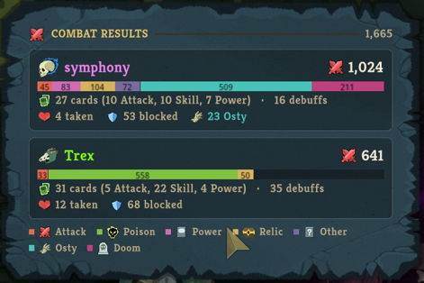

# Slay the Spire 2 - Combat Statistics Mod Fix

A small add-on that patches [Combat Statistics (by Blackdevil)](https://steamcommunity.com/sharedfiles/filedetails/?id=3781790213) for the latest game updates. It requires Combat Statistics, and only works on the beta branch of the game, same as the original mod.

Get it on the Steam workshop [Combat Statistics Fix (unofficial) [Beta]](https://steamcommunity.com/sharedfiles/filedetails/?id=3845940680)

## What it fixes
Issues since game v0.113 (The Fool update)
- Hotkey API was updated causing Continue button on defeat and victory screen to not work
- Damage call was changed, so the hooks tracking Osty and other damage sources never reach it
- Wuppy was added, and was missing damage absorbed and fainted stats

Other issues
- Combat results only displaying for the first fight when other mods cause a required font to be unloaded

## Build

- `dotnet run build.cs --no-install` (dev build in `out/`), `--dist` for the release
- `dotnet run tools/dev.cs test` runs the in-game self-test in a dev copy of the game

*MIT licensed. Slay the Spire 2 and its files belong to Mega Crit; none are included here.*
